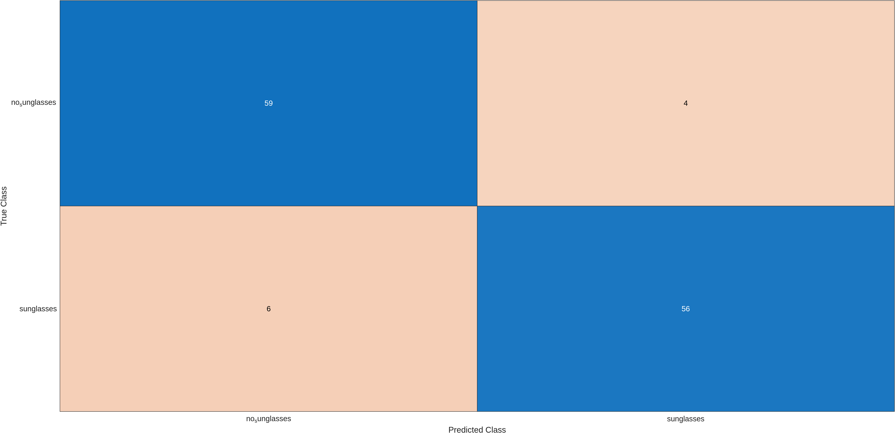
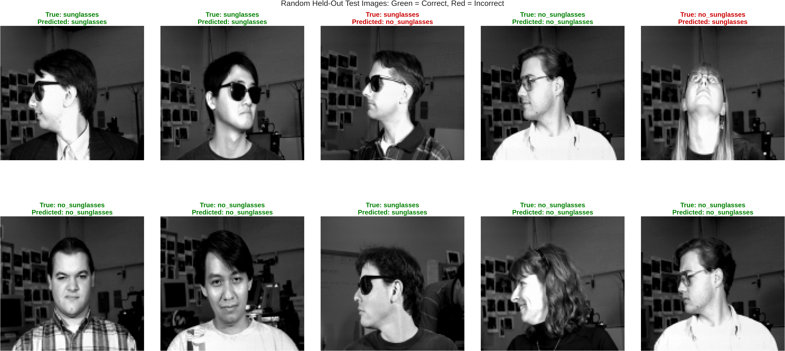
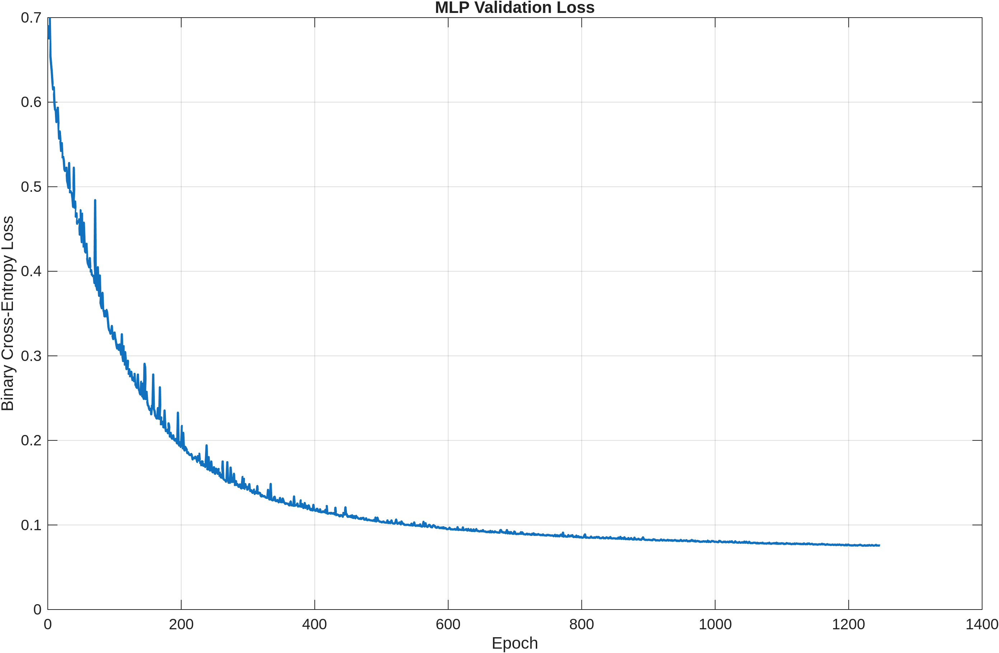
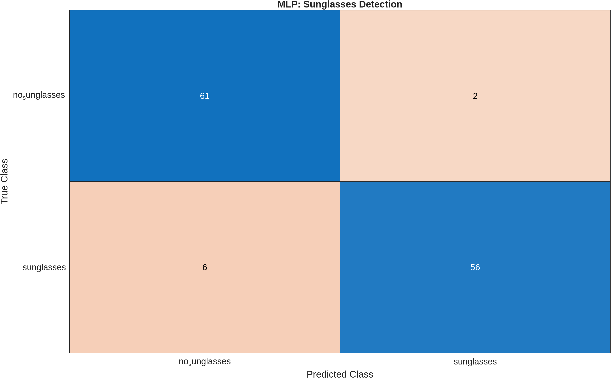
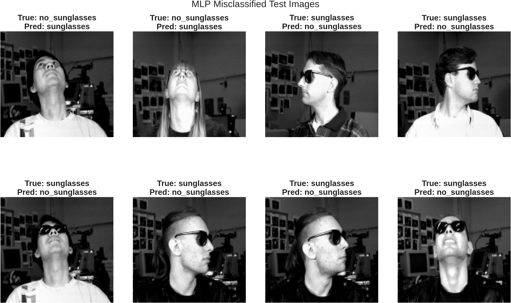

# CMU Sunglasses Detection

A MATLAB study comparing a linear Support Vector Machine (SVM) with a
custom Multi-Layer Perceptron (MLP) for classifying CMU face images as
`sunglasses` or `no_sunglasses`.

Both classifiers use normalized grayscale pixel values directly. The
scripts split the data into training and held-out test sets, train and
evaluate a model, save diagnostic plots under `images/`, and write the
trained model under `models/`.

## Contents

- [Project files](#project-files)
- [Example images](#example-images)
- [Dataset and labels](#dataset-and-labels)
- [Requirements](#requirements)
- [Run the study](#run-the-study)
- [Method](#method)
- [Recorded results](#recorded-results)
- [Limitations](#limitations)
- [References and data attribution](#references-and-data-attribution)

## Project files

```text
.
├── README.md
├── src/
│   ├── prepare_dataset.m
│   ├── SVMClassifier.m
│   └── MLPClassifier.m
├── models/
│   ├── trainedSVMModel.mat
│   └── trainedMLPModel.mat
├── images/
│   ├── an2i_straight_neutral_open.jpg
│   ├── at33_left_happy_sunglasses.jpg
│   ├── boland_right_sad_open.jpg
│   ├── ch4f_up_angry_sunglasses.jpg
│   ├── SVM_cross_validation_accuracy.png
│   ├── SVM_confusion_matrix.png
│   ├── SVM_test_predictions.png
│   ├── SVM_misclassified_images.png
│   ├── MLP_validation_loss.png
│   ├── MLP_confusion_matrix.png
│   ├── MLP_test_predictions.png
│   └── MLP_misclassified_images.png
└── cmu+face+images/
    ├── faces.tar.gz
    ├── faces.html
    └── faces.data.html
```

`src/prepare_dataset.m` extracts the archive (about 10 MB) and builds
`dataset/`. 

## Example images

Sample CMU faces from `images/`. The task is binary: **open eyes** vs
**sunglasses**.

| Open eyes | Sunglasses |
| :---: | :---: |
|  |  |
| `an2i` · straight · neutral | `at33` · left · happy |
|  |  |
| `boland` · right · sad | `ch4f` · up · angry |

## Dataset and labels

The study uses the [CMU Face Images dataset](https://www.cs.cmu.edu/~tom/faces.html).
The archive is included at `cmu+face+images/faces.tar.gz`. The preparation
script extracts it under `cmu+face+images/extracted/` and reads `.pgm`
images from the extracted `faces/` directory.

`src/prepare_dataset.m`:

1. Creates `dataset/sunglasses/` and `dataset/no_sunglasses/`.
2. Skips numbered image variants (for example, filenames ending in
   `_2.pgm`).
3. Assigns images whose filename ends in `_sunglasses.pgm` to the
   `sunglasses` class; other original images go to `no_sunglasses`.
4. Copies the original images into their class folders.

The classifiers read labels from these folder names:

```text
dataset/
├── no_sunglasses/
└── sunglasses/
```

The script does not download the archive. If it is missing, obtain it
from the dataset source and place it at `cmu+face+images/faces.tar.gz`
before running the preparation step.

## Requirements

- MATLAB R2021a or newer (the scripts use name=value argument syntax).
- Statistics and Machine Learning Toolbox (`cvpartition`, `fitcsvm`).
- Image Processing Toolbox for image conversion, display, and
  `exportgraphics`.

## Run the study

Open MATLAB, change the Current Folder to the project directory, then
run the following scripts in order:

```matlab
run("src/prepare_dataset.m")
run("src/SVMClassifier.m")
run("src/MLPClassifier.m")
```

Alternatively, open each `.m` file in MATLAB and select **Run**. The
scripts resolve project paths relative to their own locations, so they
do not require hard-coded absolute paths.

Each classifier prints metrics, shows figures, and writes PNG files to
`images/` (overwriting the previous run):

| Script | Saved figures |
| --- | --- |
| `SVMClassifier.m` | `SVM_cross_validation_accuracy.png`, `SVM_confusion_matrix.png`, `SVM_test_predictions.png`, `SVM_misclassified_images.png` |
| `MLPClassifier.m` | `MLP_validation_loss.png`, `MLP_confusion_matrix.png`, `MLP_test_predictions.png`, `MLP_misclassified_images.png` |

Trained models are saved under `models/`:

- `SVMClassifier.m` writes `trainedSVMModel.mat` (`finalSvmModel`,
  `bestBoxConstraint`, image size).
- `MLPClassifier.m` writes `trainedMLPModel.mat` (`finalMLP` weights
  and biases, hyperparameters, `bestEpoch`, image size).

These scripts train and evaluate models; they do not provide a separate
interface for scoring arbitrary photographs.

## Method

### Shared preprocessing and evaluation

- Uses an 80/20 randomized, per-class train/test split with random seed
  `42`.
- Expects grayscale images of size `120 x 128`.
- Converts each image to single precision in `[0, 1]`, then flattens it
  to a vector of 15,360 pixel features.
- Reserves the held-out test set for final evaluation.
- Reports accuracy, precision, recall, specificity, F1-score, and
  balanced accuracy, with `sunglasses` as the positive class.

### Linear SVM

`SVMClassifier.m` tests linear SVMs with
`BoxConstraint = [0.001, 0.01, 0.1, 1, 10, 100]`. It selects the value
with the best mean accuracy over five cross-validation folds on the
training split, fits a final SVM on that full training split, and
evaluates it on the held-out test split. The recorded run selected
`0.01`.

### Custom MLP

`MLPClassifier.m` implements a one-hidden-layer neural network using
sigmoid activations, binary cross-entropy, mini-batch gradient descent,
and L2 weight regularization:

| Layer | Units |
| --- | ---: |
| Input | 15,360 |
| Hidden | 64 |
| Output | 1 |

The training split is further divided into sub-training and validation
sets (80/20). Early stopping monitors validation loss, with a patience
of 25 epochs and a maximum of 3,000 epochs. The best validation epoch
is then used when training a fresh final network on the complete
training split. Scores of at least `0.5` are classified as
`sunglasses`.

## Recorded results

These figures are from one held-out test run (125 images). The scripts
print updated numbers whenever they are run.

| Metric | Linear SVM | MLP |
| --- | ---: | ---: |
| Accuracy | 92.00% | 93.60% |
| Precision | 93.33% | 96.55% |
| Recall | 90.32% | 90.32% |
| Specificity | 93.65% | 96.83% |
| F1-score | 91.80% | 93.33% |
| Balanced accuracy | 91.99% | 93.57% |
| Misclassified test images | 10 / 125 | 8 / 125 |

In this run the MLP had higher accuracy, precision, specificity,
F1-score, and balanced accuracy; recall was the same.

### SVM figures






### MLP figures








These results are specific to this dataset and split and are not a
guarantee of performance on other images.

## Limitations

- Raw pixel features do not explicitly align faces or account for
  changes in pose, lighting, or scale.
- The classifiers expect already-cropped, grayscale images with the
  exact dimensions used by the study; resizing a photograph alone does
  not locate or align a face.
- The dataset is limited in size and source. Results on external images
  may differ substantially.
- The reported metrics are from a held-out split, not an independent
  external evaluation.

## References and data attribution

- [CMU Neural Networks for Face Recognition — CMU Face Images](https://www.cs.cmu.edu/~tom/faces.html)
- [UCI Machine Learning Repository — CMU Face Images](https://archive.ics.uci.edu/dataset/124/cmu%2Bface%2Bimages)
